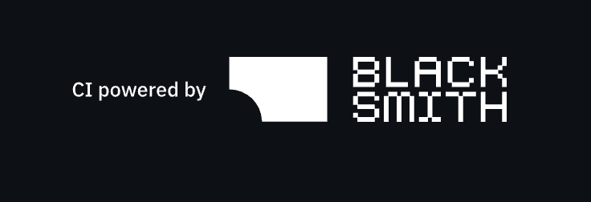

# actix-limitation

> Rate limiter using a fixed window counter for arbitrary keys, backed by Redis or an in-memory store, for Actix Web.  
> Originally based on <https://github.com/fnichol/limitation>.

<!-- prettier-ignore-start -->

[](https://crates.io/crates/actix-limitation)
[](https://docs.rs/actix-limitation/0.7.0)

[](https://deps.rs/crate/actix-limitation/0.7.0)

<!-- prettier-ignore-end -->

## Backends

Redis shares counters across application instances that use the same database. Enable `redis-native-tls` or `redis-rustls` for TLS.

With the `memory-store` feature, counters live in the application process and reset on restart. Build the store outside `HttpServer::new` and clone it into each worker to share counters.

## Examples

Both examples allow five requests per peer IP in a ten-second window. Run the [in-memory example](examples/memory.rs) with:

```console
cargo run --example memory --features memory-store
```

For the [Redis example](examples/redis.rs), start Redis and run the server:

```console
docker run --rm -d -p 127.0.0.1:6379:6379 redis:8
cargo run --example redis
```

From another terminal, repeat `curl -i http://127.0.0.1:8080/` six times within ten seconds. The sixth request returns HTTP 429.

## Sponsors

<a href="https://www.blacksmith.sh/">
  
</a>
